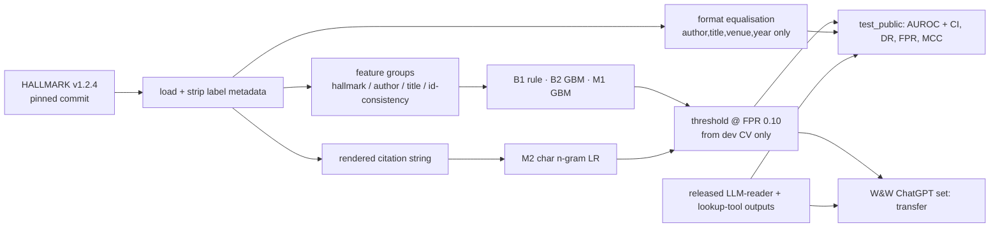

# Frozen experiment blueprint (Prompt 07)

Frozen on 2026-11-04 together with `configs/experiment.yaml`. At the time of
freezing, the only model outputs I had seen were those of HALLMARK's own
four-mode shortcut control (`scripts/02_validate_baseline.py`). No model built in
this project had been scored on `test_public` or on the W&W set.

## Question and hypotheses

| ID | Hypothesis (stated before results) | Supported if | Contradicted if |
|----|----|----|----|
| H1 | On HALLMARK, surface-only detectors carry real signal, and most of it sits in Tier-1 types that have visible defects (placeholder authors, future dates, fake DOI prefixes). | M1 test AUROC CI lower bound > 0.5; Tier-1 DR > Tier-3 DR | AUROC CI includes 0.5, or Tier-3 DR ≥ Tier-1 DR |
| H2 | A surface detector trained on HALLMARK does not transfer to ChatGPT citations where real and fake share a generator and format. | W&W AUROC ≤ 0.60 or CI includes 0.5 | W&W AUROC CI lower bound > 0.60 |
| H3 | Even when trained on W&W itself (grouped by topic), surface/text features fall well short of the AUC 0.876 that Naser (2026) reports for a string-only classifier. | grouped-CV AUROC < 0.80 | grouped-CV AUROC ≥ 0.80 |

H1 is the "format is informative" side; H2/H3 are the "format is miscalibrated" side. Either outcome is reportable.

## Pipeline

## Inputs and outputs
- Input: one BibTeX-like record (`fields` dict + `bibtex_type`). Everything else in the record is dropped before features are computed (list in the config).
- Output: a score in [0,1] = estimated probability that the reference is hallucinated, plus a binary decision at the frozen threshold.

## Partitions and controls
- Fit and tune only on `dev_public`. Threshold chosen from 5-fold stratified CV predictions on `dev_public`.
- `test_public` is scored once per model and seed. W&W is scored once for transfer; for within-W&W CV, folds are grouped by topic (`ww_<n>_t<topic>_…` in the key) so that citations from the same literature review never sit in both train and test.
- Same learner and hyper-parameters (sklearn defaults, as in HALLMARK) for B2 and M1: the only change is the feature set.

## Deeper analyses (at least one required; five planned)
1. Per-type and per-tier detection rates on `test_public`.
2. Feature-group ablation: drop each group from M1, report ΔAUROC (5 seeds).
3. Format equalisation: render every record as {author, title, venue, year} and (a) score with models trained on full records, (b) retrain on equalised dev.
4. Transfer to W&W and within-W&W grouped CV.
5. Error analysis: which hallucinations M1 scores as most "real".

## Threats to validity
- **Benchmark artefacts.** HALLMARK's VALID entries are scraped from DBLP; most hallucinated entries are generated. Surface differences may reflect provenance, not fabrication. The W&W set controls for this.
- **Label noise.** HALLMARK relabelled entries in v1.2.3/1.2.4; W&W labels are human-coded but were parsed from APA strings (the HALLMARK docs record a fixed author-parsing bug).
- **Small external set.** 341 entries; CIs will be wide.
- **Released comparators** were produced by other people at earlier dates; I re-score their per-entry outputs against v1.2.4 labels but cannot verify their run conditions.

## Pre-experiment checklist
- [x] Primary metric fixed (AUROC) and its direction (higher better)
- [x] Test split fixed (`test_public`); never used for fitting or thresholds
- [x] Threshold rule fixed (FPR ≈ 0.10 on dev CV)
- [x] Seeds fixed (0–4); bootstrap seed 0, 1,000 resamples
- [x] Comparators and feature groups fixed in `configs/experiment.yaml`
- [x] Label-leaking record fields listed and excluded

## Logging later changes
Any change after freezing goes in `research_decisions.md → Protocol changes`
with date, reason, and whether results were already seen.
